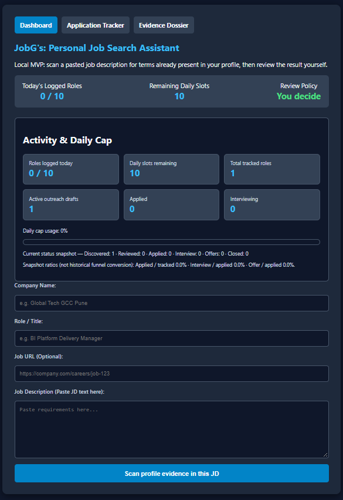
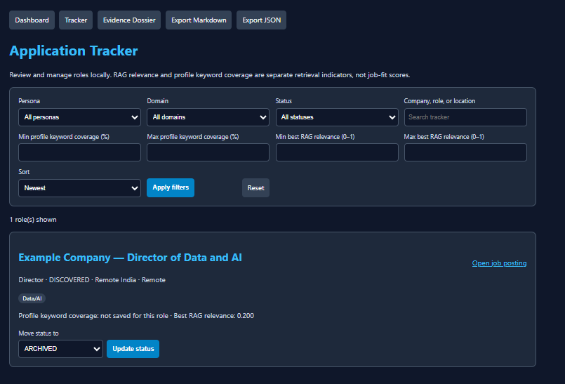
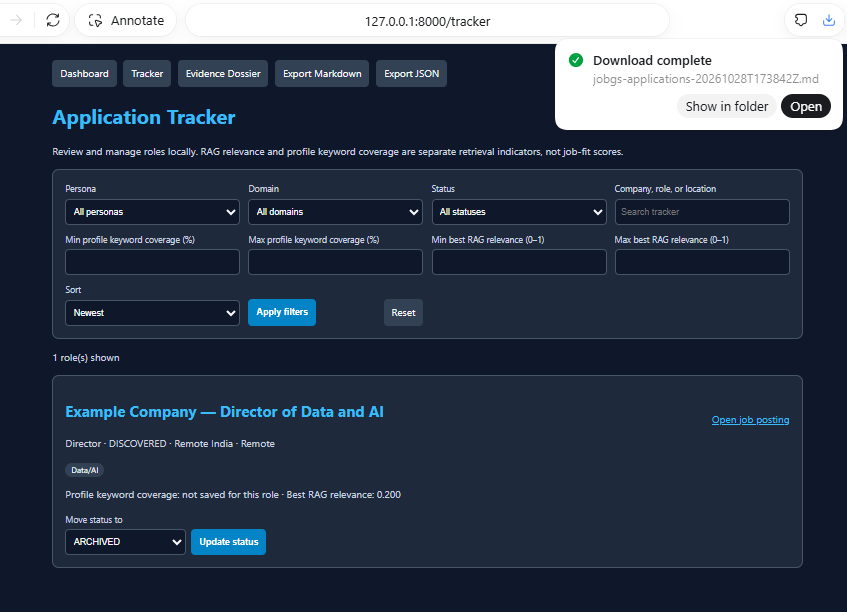

# JobG's — Personal Executive Job-Search Assistant

Copyright (c) 2026 Amith Raul. All rights reserved. See [LICENSE](LICENSE) for the project's reuse terms.

**Current release:** `v1.6`
**Project status:** Four-week personal MVP completed; follow-on AI learning and product work remain planned.
**Intended use:** One candidate, running locally on their own PC.

## Why this MVP exists

Preparing and submitting a single job application can take about 50 minutes when the candidate repeatedly researches a role, compares it with several versions of a resume, rewrites materials, and tracks the result by hand. JobG's was built to reduce that repeated preparation and administration effort and to make the reasoning easier to inspect. Its focus is evidence-backed role review, reusable profile facts, persona selection, application tracking, and exportable notes.

JobG's does **not** promise to bypass ATS systems or prevent rejection. It helps surface relevant candidate-provided evidence, literal profile-term coverage, and possible technology adjacencies so the candidate can prepare a more targeted and truthful application. A hiring system may still reject an application for many reasons. The candidate reviews each result and submits applications manually.

This is a personal workflow MVP and learning portfolio—not a public multi-user service or a commercial job marketplace.

## What v1.6 contains

- **Profile and evidence dossier:** SQLite stores a local master profile and candidate-authored claims, with persona tags, provenance notes, and confidentiality labels.
- **Three executive tracks:** Director / Senior Director, Senior Platform Architect, and Principal TPM / Delivery Lead.
- **Job intake and triage:** Manually supplied job information is triaged through rule-based persona, domain, and location suggestions. `/api/triage-job` previews a role; `/api/add-job` saves it as `DISCOVERED` for review.
- **Local evidence retrieval:** `rag_matcher.py` combines lexical overlap with local Ollama `nomic-embed-text` embeddings. Persona weighting changes the evidence ordering. Retrieval relevance is not job fit, proficiency, or truth verification.
- **Transferable technology bridges:** Allowlisted conceptual-adjacency drafts are returned only when an eligible, non-confidential SQLite claim supports the source technology. Drafts include provenance and disclaimers; they do not assert use of the target technology.
- **Human-governed tracker:** Lifecycle updates are restricted to allowed transitions. The dashboard filters by persona, domain, status, search text, profile coverage, and retrieval relevance.
- **Activity and offline review:** Summary metrics, the 10-role daily logging cap, and Markdown/JSON exports help organize the process. The cap counts locally logged roles; it does not confirm external submissions.
- **No external automation:** JobG's does not crawl job boards, send LinkedIn messages, log in to job portals, or submit applications. It can draft outreach text for the candidate to review.

## How the workflow fits together

```text
Candidate finds a role and supplies its URL and job description
        ↓
FastAPI validates the supplied fields
        ↓
Rule-based triage suggests persona, domain, and location/work model
        ↓
Local Ollama hybrid retrieval ranks eligible SQLite evidence
        ↓
Evidence-backed bridge drafts and outreach draft are prepared for review
        ↓
Candidate reviews and saves the role as DISCOVERED
        ↓
Candidate updates status manually, applies externally, and exports notes if useful
```

SQLite is the source of truth. The vector embedding table is a derived local cache. Company inventory records are created or updated on demand from supplied company information; there is no large preloaded global directory or automated directory crawler.

## Screenshots

These local UI snapshots show the dashboard, tracker, and Markdown export workflow. They illustrate the interface; they are not substitutes for automated tests or evidence of ATS outcomes.

### Dashboard and daily activity



### Application tracker



### Markdown export



## Technology

- Python 3.10+ (the project has also been exercised with Python 3.14)
- FastAPI, Uvicorn, Pydantic, and Jinja2
- SQLite for profile evidence, company inventory, job records, and the rebuildable embedding cache
- Ollama with `nomic-embed-text` for local embedding generation
- PowerShell is intended to manage the Ollama query lifecycle for the API workflow
- `unittest` and GitHub Actions for automated checks

## Repository map

```text
JobG's/
├── README.md                         # This product and setup overview
├── PRODUCT_OVERVIEW.md               # Goals, workflow, boundaries, and architecture
├── CHANGELOG.md                      # Tagged release history through v1.6
├── MVP_BUILD_PLAN.md                 # MVP scope and completed learning record
├── AI_UPSKILLING_ROADMAP.md           # Completed Weeks 1–4 and planned Weeks 5–24
├── EVIDENCE_PROFILE_GUIDE.md          # Safe, evidence-aware profile data guidance
└── docs/
    ├── Week-1-Milestone.md            # Local retrieval foundation
    ├── Week-2-Milestone.md            # Job intake, triage, and SQLite inventory
    ├── Week-3-Milestone.md            # Persona weighting and evidence-grounded bridges
    ├── Week-4-Milestone.md            # Tracker, analytics, filters, and exports
    ├── adr/                           # Architecture decision records
    └── evaluations/                   # Sanitized retrieval evaluation notes

└── jobgs-engine/
├── app.py             # FastAPI UI and API routes
├── database.py        # SQLite schemas, additive migration, and analytics
├── evidence.py        # Validated evidence claim persistence
├── matcher.py         # Transparent profile scan and bridge drafts
├── rag_matcher.py     # Local lexical + semantic evidence retrieval
├── job_copilot.py     # Job triage, managed RAG call, and role persistence
├── ingest_companies.py# Validated company inventory upsert
├── tracker.py         # Tracker filters, guarded states, and exports
├── templates/         # Jinja2 evidence and tracker views
└── tests/             # Local unit tests
```

> **Current checkout note:** `job_copilot.py` expects `run_rag_session.ps1` in `jobgs-engine`, but that script is not present in this checkout. Until it is restored and reviewed, `/api/triage-job` and `/api/add-job` cannot complete their managed hybrid-RAG path; they should return a clear service error. The standalone `rag_matcher.py` CLI can be run separately when Ollama is started manually. Documentation does not treat this missing file as a passing lifecycle test.

## Run locally on Windows

From the repository root, use PowerShell:

```powershell
Set-Location "projects\JobG's\jobgs-engine"
python -m venv venv
.\venv\Scripts\Activate.ps1
python -m pip install --upgrade pip
python -m pip install -r requirements.txt
python database.py
python app.py
```

Open <http://127.0.0.1:8000/>. The web server is intended to bind to loopback for local use; stop it with **Ctrl+C**. API documentation is at <http://127.0.0.1:8000/docs>.

The setup command creates a virtual environment and the local SQLite database. The database file, resumes, evidence text, embedding cache, Ollama model files, and secrets must stay out of Git. The application has no login and SQLite is not encrypted; local-first is a data-flow choice, not an encryption or access-control guarantee.

## Local retrieval

Install Ollama separately and download the embedding model once:

```powershell
ollama pull nomic-embed-text
ollama serve
```

In another terminal, from `jobgs-engine`:

```powershell
python rag_matcher.py "cloud data platform architecture" --persona Architect
python rag_matcher.py "multi-cloud transformation" --keywords-only
```

The first command uses hybrid retrieval only if the local Ollama API is available; otherwise it reports lexical fallback. Stop a manually started server using the Ollama app/service controls or the terminal running it. API job triage is stricter: it requires the managed wrapper described in the checkout note above and rejects fallback output.

## Tests and CI

Run the local unit suite from `jobgs-engine`:

```powershell
python -m unittest discover -s tests -v
```

The repository currently contains 34 test methods across evidence, job workflow, retrieval, bridges, and tracker modules. Run the command above to verify the current environment; this README does not claim a fresh test run. GitHub Actions also runs the configured project checks on pull requests.

## Documentation and release history

- [Product overview and architecture](PRODUCT_OVERVIEW.md)
- [Week 1 milestone](docs/Week-1-Milestone.md)
- [Week 2 milestone](docs/Week-2-Milestone.md)
- [Week 3 milestone](docs/Week-3-Milestone.md)
- [Week 4 milestone / v1.6](docs/Week-4-Milestone.md)
- [Changelog](CHANGELOG.md)
- [GitHub Wiki](https://github.com/raulkbd101-ai/AI-ProjectsAKR/wiki)

The `v1.6` tag represents the completed four-week MVP milestone. The long-term roadmap continues beyond this release; “MVP complete” does not mean autonomous applications, hosted deployment, or a commercial product are complete.
