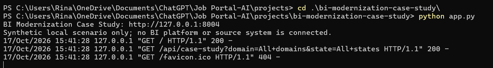
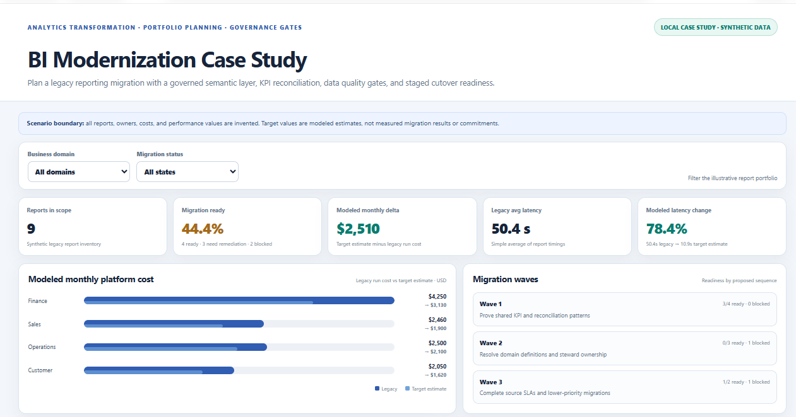
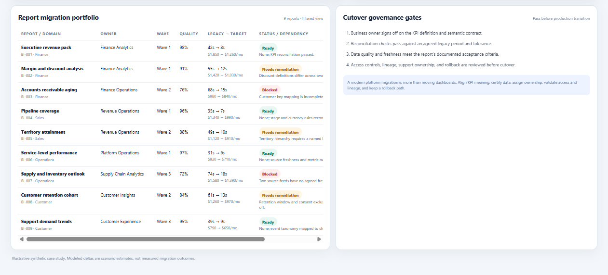
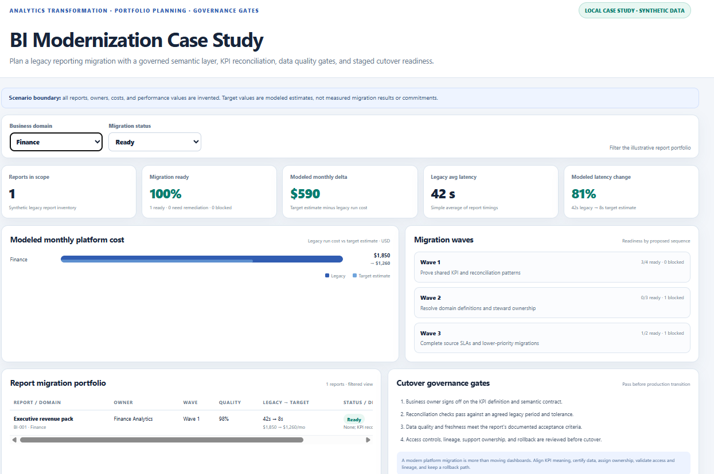

# BI Modernization Case Study

A local, interactive case study for planning a legacy business-intelligence migration. The dashboard uses a fictional nine-report portfolio to explore migration readiness, modeled platform cost and latency changes, sequencing, KPI reconciliation, and cutover governance.

## What it demonstrates

- A report inventory with domains, business owners, legacy sources, candidate target models, and migration waves.
- Readiness states that make report dependencies and blockers explicit.
- Modeled comparisons between legacy run cost and target monthly cost estimates, plus legacy and target query latency estimates.
- Filters by business domain and migration status.
- A staged migration plan and governance gates for semantic/KPI parity, data quality, access, lineage, support, and rollback.
- Standard-library tests for portfolio totals, filters, calculations, wave coverage, and invalid input.

## Run locally

Requires Python 3.10 or later. The demo uses only the Python standard library; no packages, BI credentials, or external services are required.

From the repository root in PowerShell:

```powershell
Set-Location ".\projects\bi-modernization-case-study"
python app.py
```

Open [http://127.0.0.1:8004](http://127.0.0.1:8004). Keep the terminal open while using the dashboard and stop it with `Ctrl+C`.

If port 8004 is already in use, use another local port:

```powershell
$env:DEMO_PORT = "8014"
python app.py
```

Then open `http://127.0.0.1:8014`.

## Explore the case

Use the domain and migration-status filters to narrow the report portfolio. Inspect each report's business owner, data-quality score, proposed migration wave, legacy and target estimates, and the dependency that must be resolved. Compare the readiness mix and modeled estimates across domains.

The first wave is intended to prove shared KPI definitions and reconciliation. Later waves surface issues around metric definitions, ownership, customer mappings, and source freshness. The dashboard treats a report as ready only when its illustrative case record says it is ready; the metrics are not a production migration recommendation.

## Local demo evidence

The screenshots below were captured from the app running locally. They show the server and dashboard/API requests, the full nine-report portfolio, the cutover governance gates, and the Finance + Ready filtered view. All displayed records and figures remain synthetic case-study data.









## Run tests

From the project directory:

```powershell
python -m unittest discover -s tests -v
```

Captured output is saved in [`evidence/test-results.txt`](evidence/test-results.txt).

## How the model works

- `modernization.py` contains the synthetic report inventory and deterministic filter and summary calculations.
- `app.py` provides the local dashboard and `/api/case-study` JSON endpoint.
- `index.html` renders the interactive portfolio, cost comparison, migration waves, and cutover gates.
- `tests/test_modernization.py` checks totals, filter behavior, edge cases, wave coverage, and disclosure fields.

## Scenario boundaries

Every report, owner, cost, quality score, latency, target model, and dependency is invented for this learning case study. Target values are modeled estimates; no migration has been performed or measured. The project does not connect to a BI platform, data warehouse, or cloud account. It does not assess actual business KPIs or recommend a vendor. The figures must not be presented as real project results.

A real modernization effort would require discovery with business and technical owners, agreed metric definitions, source-to-target lineage, reconciliation tolerances, access and privacy controls, performance benchmarks, cutover planning, rollback, and post-migration monitoring.

## License

MIT. See [LICENSE](LICENSE).
