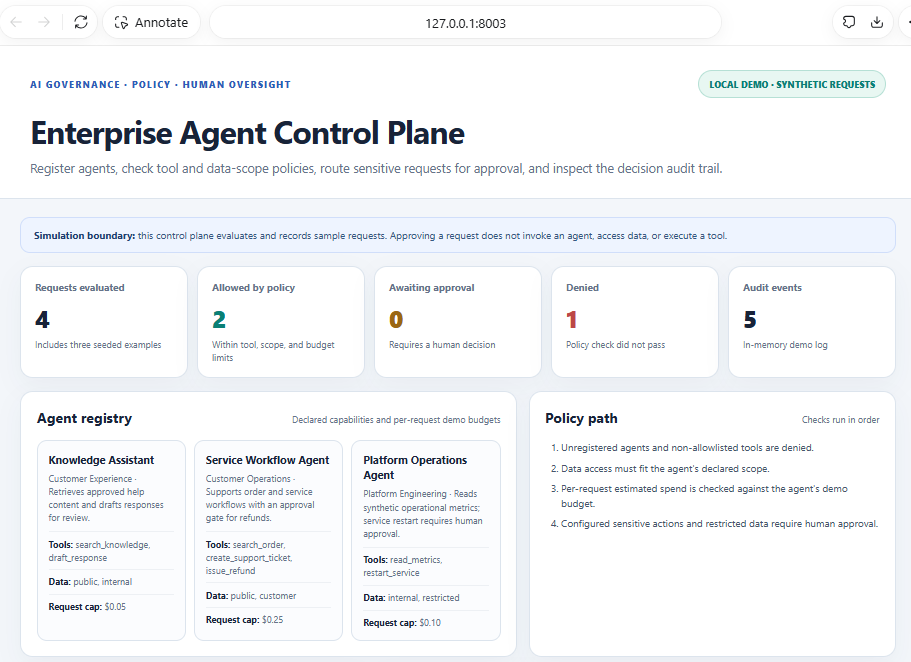
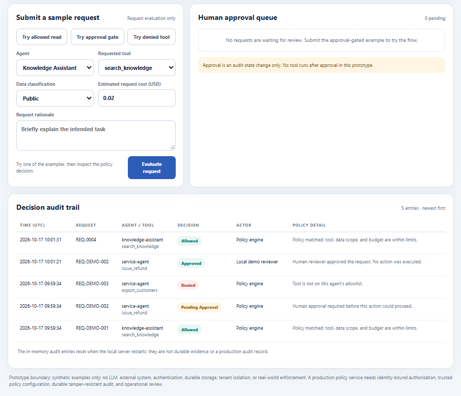

# Enterprise Agent Control Plane

Copyright (c) 2026 Amith Raul. All rights reserved. Reuse of current versions is not granted without separate written permission. See [LICENSE](LICENSE). Earlier versions distributed under MIT retain their historical terms; see [LICENSE-MIT-PRIOR-VERSIONS.txt](LICENSE-MIT-PRIOR-VERSIONS.txt).

A small, local governance simulation for reviewing what enterprise agents may request. It combines an agent registry, tool allowlists, data scopes, per-request cost limits, human approval gates, and a chronological audit view.

## What it demonstrates

- Three example agents with declared owners, tools, data classifications, and illustrative request budgets.
- Deterministic policy checks for agent registration, allowed tools, data scope, and estimated cost.
- Human review for sensitive actions such as refunds and service restarts, and for requests using restricted data.
- A dashboard to submit example requests, approve or reject pending requests, and inspect decisions.
- Unit tests for policy outcomes, validation, reviewer decisions, and audit records.

## Run locally

Requires Python 3.10 or later. The app uses only the Python standard library; no package installation is needed.

In PowerShell, from the repository root:

```powershell
Set-Location ".\projects\enterprise-agent-control-plane"
python app.py
```

Open [http://127.0.0.1:8003](http://127.0.0.1:8003). Keep the PowerShell window open while using the demo. Stop the server with `Ctrl+C`.

If port 8003 is already in use, choose another local port before starting:

```powershell
$env:DEMO_PORT = "8013"
python app.py
```

Then open `http://127.0.0.1:8013`.

## Try the demo

The dashboard starts with three synthetic examples: one allowed read, one refund waiting for approval, and one request denied because its tool is outside the agent allowlist. Use the buttons to load an allowed read, an approval-gated request, or a denied tool into the form. Select **Evaluate request** to record a policy decision. Use the approval queue to approve or reject a pending example and see the reviewer event appear in the audit trail.

The seeded state begins with 3 requests and 3 audit events. Requests submitted in the dashboard are added to that in-memory state. Restarting the server resets it.

## Governance concept

The key idea is to put a policy decision point between an agent and any action it might request. The control plane compares each request with a registered agent's declared tools, data scope, and cost limit. It allows requests that pass those checks, denies requests that fail, and sends configured sensitive actions to a human reviewer. The decision and reviewer are then written to the audit view.

This separation makes policy outcomes visible and reviewable before a real execution layer is connected. In this starter, that execution layer is intentionally absent: approval only changes the recorded decision to `approved`; it does not trigger the requested action.

## Local demo evidence

These screenshots were captured from the running local demo. The overview shows the registry and policy checks. The audit screenshot shows an allowed request and a refund approval recorded by the reviewer; the interface explicitly reports that no action was executed.





## Run tests

From the project directory:

```powershell
python -m unittest discover -s tests -v
```

The test output is saved in [`evidence/test-results.txt`](evidence/test-results.txt).

## Architecture

- `control_plane.py` contains the registry, policy evaluation, request state transitions, and in-memory audit events.
- `app.py` serves the dashboard and a small JSON API using Python's built-in HTTP server.
- `index.html` renders the dashboard and calls the local API.
- `tests/test_control_plane.py` exercises the deterministic policy model.

## Prototype boundaries

All agents, requests, data labels, costs, and decisions are illustrative. No LLM is called, no customer or cloud data is accessed, and no agent tool is invoked—even after approval. State and audit entries live only in memory and are lost when the server restarts. This local demo has no authentication, durable audit storage, tenant isolation, or production security enforcement. Do not expose the development server to a network or use it to authorize real actions.

The dashboard is a learning artifact for exploring control-plane concepts. A production design would need identity-bound authorization, trusted policy administration, durable tamper-resistant audit records, monitoring, and operational controls.
