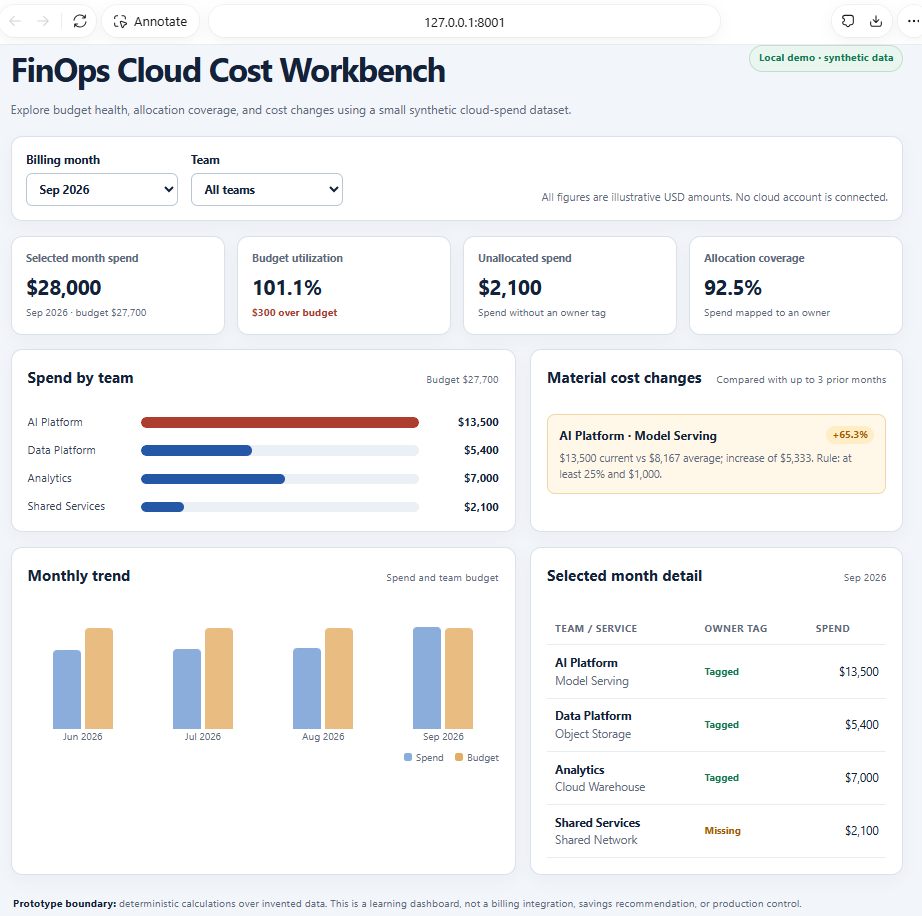
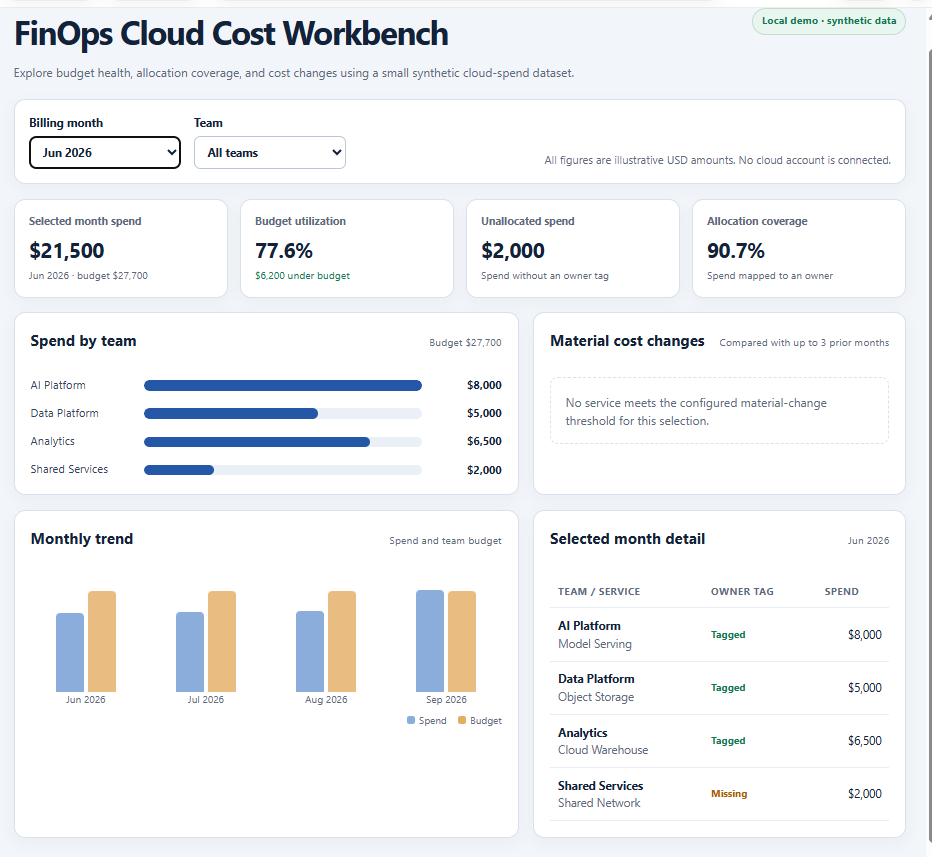
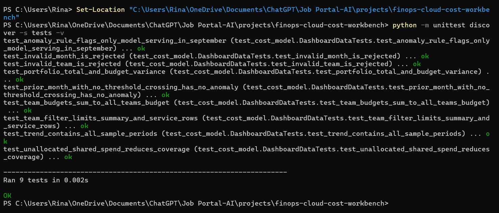

# FinOps Cloud Cost Workbench

Copyright (c) 2026 Amith Raul. All rights reserved. Reuse of this project's original code and materials is not granted without separate written permission. See [LICENSE](LICENSE).

A small local FinOps demo for reviewing cloud spend against team budgets, checking allocation coverage, and flagging material service-cost increases. It uses invented data and deterministic calculations; it makes no cloud calls and uses no LLM.

This project translates enterprise platform, SRE, and FinOps experience into a runnable learning artifact. It models cost-control questions without presenting synthetic results as personal business outcomes. The data and thresholds here are illustrative.

## What it demonstrates

- Monthly cloud spend compared with team budgets.
- Budget variance and utilization, with a filter for one team or all teams.
- Allocation coverage, including spend that lacks an owner tag.
- Deterministic service anomaly flags against the prior three months.
- A read-only local dashboard backed by a small JSON API.
- Automated checks for calculations, filters, invalid inputs, and anomaly behavior.

The sample data deliberately includes one service increase above the configured threshold and a shared network line without an owner tag. These are teaching examples, not findings from a real cloud account.

## Run locally

Requirements: Python 3.10 or newer. The project uses only the Python standard library; no install step, cloud credentials, or external services are required.

From the repository root:

```bash
cd projects/finops-cloud-cost-workbench
python app.py
```

Open <http://127.0.0.1:8001>. Use the month and team selectors to explore the sample cost data. The server binds to loopback by default; do not expose this demo server to a network.

## Run the checks

From the project directory:

```bash
python -m unittest discover -s tests -v
```

The captured run is in [`evidence/test-results.txt`](evidence/test-results.txt). The suite checks the same deterministic rules shown in the dashboard. The user-run command-line result is also captured in [`evidence/local-test-run.png`](evidence/local-test-run.png).

## Local demo evidence

The screenshots below were captured from the dashboard running on the author's laptop at `127.0.0.1:8001`, using the included synthetic dataset. They show the September 2026 budget overrun and material Model Serving increase, and the June 2026 comparison with no material-change flag. These are reproducible demo outputs, not cloud-account data or production findings.

**September 2026 — all teams:** $28,000 spend against a $27,700 budget (101.1% utilization), $2,100 unallocated, and 92.5% allocation coverage. Model Serving is flagged at +65.3% against its prior-month average.



**June 2026 — all teams:** $21,500 spend against a $27,700 budget (77.6% utilization), with no service meeting the material-change threshold.



The user ran the project checks locally: all 9 unit tests passed.



## How the calculations work

1. `cost_model.py` holds the invented monthly service costs, ownership tags, and team budgets.
2. `dashboard_data()` validates the requested month and team, then calculates spend, budget variance, utilization, and allocation coverage.
3. For each service in the selected month, the anomaly rule compares its cost with the average of available prior months. A flag appears when cost is at least 25% higher and at least $1,000 above that baseline.
4. `app.py` serves `index.html` and the JSON endpoint at `/api/dashboard`. Inputs are validated before data is returned.
5. `tests/test_cost_model.py` checks portfolio totals, team filters, allocation calculations, anomaly thresholds, trend data, and invalid inputs.

## Governance and limitations

This is a local portfolio prototype, not a cloud billing integration or production FinOps control. It uses hard-coded synthetic data, a simple illustrative threshold, no authentication, no cloud provider APIs, and no LLM. It does not recommend or execute savings actions. A production implementation would need trusted billing exports, ownership and tag standards, account-level access controls, threshold calibration, data retention rules, alert routing, and operational monitoring.

## Suggested learning path

Use the test suite to change a budget or threshold and observe how the dashboard and checks respond. Then document the policy behind the threshold, add tests for edge cases, and consider how a real billing export would be validated before it feeds a dashboard. Keep recommendations advisory until a human reviews the evidence.

## License

MIT. See [LICENSE](LICENSE).
