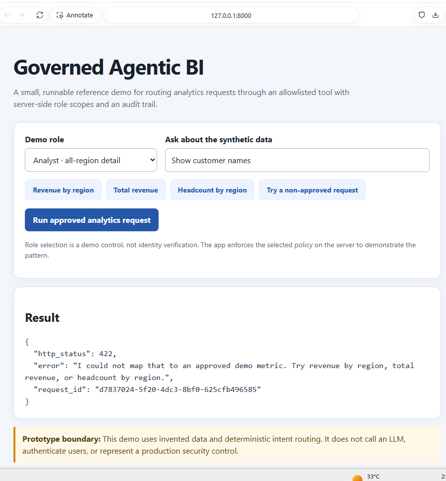
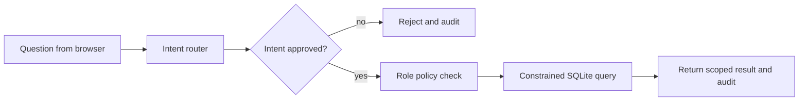

# Governed Agentic BI Demo

Copyright (c) 2026 Amith Raul. All rights reserved. Reuse of this project's original code and materials is not granted without separate written permission. See [LICENSE](LICENSE).

This project shows a small, inspectable version of a pattern used in enterprise analytics: receive a request, map it to an approved operation, check what the caller may see, run a constrained query, and record the decision.

It uses synthetic data and deterministic intent routing. It makes **no LLM calls**. That is deliberate: governance can be designed and demonstrated before adding a model. A model may later help interpret language, but it should never decide its own data access.

## What this demonstrates for governance

This is a local governance learning project, not a production governance service. It makes several controls concrete and easy to inspect:

- A short allowlist limits which analytics operations can run.
- A server-side policy scopes results by role, even though the role picker itself is only a demo control.
- Unsupported questions and out-of-scope requests are denied.
- Each decision gets a request ID and a JSON Lines audit record; the raw question is not recorded.
- Fixed SQL and synthetic data keep the demo's data path understandable and safe to publish.

These controls can be used to discuss policy design, test role boundaries, and show how an analytics request can be traced. They do not establish real identity, regulatory compliance, or production security. The project remains useful without an LLM; adding one is optional and should not weaken the backend policy checks.

## Local demo evidence

The screenshot below was captured from the app running at `127.0.0.1:8000`. It shows the interface loaded locally and an unsupported request receiving HTTP 422 with a request ID. This is evidence of a working local UI and rejection path, not a security certification.



## Run it on your laptop

You need Python 3.10 or newer. The demo uses only Python's standard library, so there are no packages to install.

```bash
cd projects/governed-agentic-bi-demo
python app.py
```

Open <http://127.0.0.1:8000>. The app creates a small SQLite database from invented rows on first run. Each request is written to `audit.jsonl`.

## Try these scenarios

1. Select **Analyst** and ask “Show revenue by region.” You should see all four regions.
2. Select **Regional manager** and repeat the request. The server scopes the result to West.
3. Select **Executive viewer** and ask “What is total revenue?” The viewer can see a total but not the regional breakdown.
4. As Executive viewer, ask for revenue by region. The server denies the request because this role is totals-only.
5. Ask “Show customer names.” The request is denied because that operation is not in the approved intent list.

## What happens when you ask a question



1. The browser sends a question and a selected demo role to `/api/ask`.
2. `classify_intent()` maps supported phrases to one of three fixed intent names.
3. `run_approved_query()` checks the role policy on the server. Regional managers are restricted to West; executive viewers cannot see detailed rows.
4. The application runs a fixed SQL query. User text is never inserted into SQL.
5. `record_audit()` writes a request ID, UTC timestamp, role, intent, outcome, and denial reason where needed. It does not save the raw question.

## Why the role selector is only a demo

The browser can choose the role, so a real user could change it. This makes it useful for demonstrating policy branches, but it is not authentication. In a real system, a trusted identity provider would supply identity and role claims; the backend would validate them and enforce policy independently of browser input.

## What to learn from the code

- **Separate interpretation from authorization.** The router proposes an intent; the policy check decides whether that role can run it.
- **Fail closed.** Unsupported requests and disallowed detail views are rejected.
- **Keep the tool surface small.** Only fixed metrics and query shapes are available.
- **Audit decisions.** A request ID makes an allowed or denied decision easier to trace.
- **Use fake data in a public portfolio.** It avoids exposing employer or customer information.

## Current boundaries

This is a portfolio prototype. It does not call an LLM, authenticate users, implement enterprise-grade access controls, or provide a production audit system. Do not expose the local server to a network. Before production use, add trusted identity, a policy engine, tests for role boundaries, TLS, rate limits, secrets management, audit retention controls, and monitoring. If a model is added later, evaluate its intent proposals and tool use separately; the backend must continue to enforce authorization.

## Next governance steps

1. Add tests for every role and intent combination, including denied requests.
2. Document a role-to-metric policy matrix and check that the API behavior matches it.
3. Add audit review and retention guidance, then decide what a real deployment should record.
4. Replace the demo role picker with trusted identity claims and a maintained policy source before any real use.

An LLM is not required for these steps. If a model-based parser is explored later, keep its output limited to proposing an allowlisted intent; authorization must remain enforced by the backend.

## License

MIT. See [LICENSE](LICENSE).
