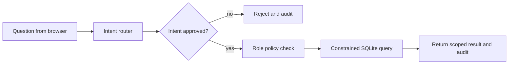

# Governed Agentic BI Demo

This project shows a small, inspectable version of a pattern used in enterprise analytics: receive a request, map it to an approved operation, check what the caller may see, run a constrained query, and record the decision.

It uses synthetic data and deterministic intent routing. There is no LLM call yet. That is deliberate: first learn where authorization belongs and how to make decisions visible. A model can help interpret language later, but it should not be allowed to grant itself data access.

## Run it on your laptop

You need Python 3.10 or newer. The demo uses only Python's standard library, so there are no packages to install.

```bash
cd projects/governed-agentic-bi-demo
python app.py
```

Open <http://127.0.0.1:8000>. The app creates a small SQLite database from invented rows on first run. Each request is written to `audit.jsonl`.

## Try these scenarios

1. Select **Analyst** and ask “Show revenue by region.” You should see all four regions.
2. Select **Regional manager** and repeat the request. The server scopes the result to West.
3. Select **Executive viewer** and ask “What is total revenue?” The viewer can see a total but not the regional breakdown.
4. As Executive viewer, ask for revenue by region. The server denies the request because this role is totals-only.
5. Ask “Show customer names.” The request is denied because that operation is not in the approved intent list.

## What happens when you ask a question



1. The browser sends a question and a selected demo role to `/api/ask`.
2. `classify_intent()` maps supported phrases to one of three fixed intent names.
3. `run_approved_query()` checks the role policy on the server. Regional managers are restricted to West; executive viewers cannot see detailed rows.
4. The application runs a fixed SQL query. User text is never inserted into SQL.
5. `record_audit()` writes a request ID, UTC timestamp, role, intent, outcome, and denial reason where needed. It does not save the raw question.

## Why the role selector is only a demo

The browser can choose the role, so a real user could change it. This makes it useful for demonstrating policy branches, but it is not authentication. In a real system, a trusted identity provider would supply identity and role claims; the backend would validate them and enforce policy independently of browser input.

## What to learn from the code

- **Separate interpretation from authorization.** The router proposes an intent; the policy check decides whether that role can run it.
- **Fail closed.** Unsupported requests and disallowed detail views are rejected.
- **Keep the tool surface small.** Only fixed metrics and query shapes are available.
- **Audit decisions.** A request ID makes an allowed or denied decision easier to trace.
- **Use fake data in a public portfolio.** It avoids exposing employer or customer information.

## Current boundaries

This is a portfolio prototype. It does not call an LLM, authenticate users, implement enterprise-grade access controls, or provide a production audit system. Do not expose the local server to a network. Before production use, add trusted identity, a policy engine, tests for role boundaries, TLS, rate limits, secrets management, audit retention controls, monitoring, and a model/tool evaluation process.

## Next learning steps

1. Add tests for every role and intent combination.
2. Add a small evaluation set for supported, ambiguous, and denied questions.
3. Add an MCP adapter that exposes only the same approved analytics operations.
4. Add a model-based intent parser while keeping authorization in the backend.

## License

MIT. See [LICENSE](LICENSE).
