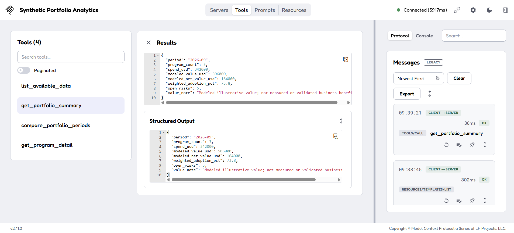
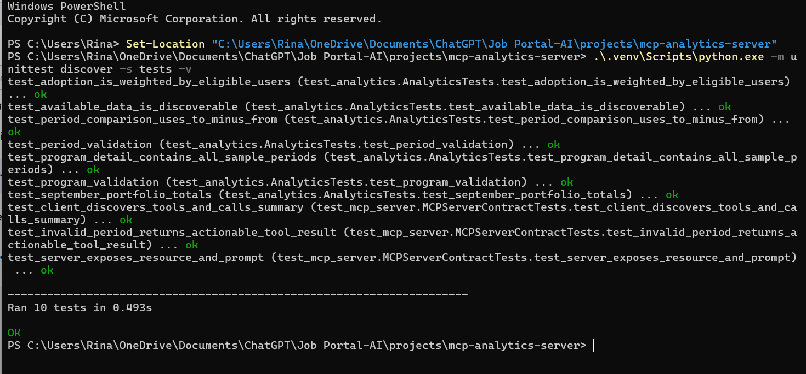

# MCP Analytics Server

A local Model Context Protocol (MCP) server that exposes read-only analytics over an invented enterprise AI portfolio dataset. It demonstrates how a client can discover tools and call structured analytics through MCP. The server does not include or call an LLM, connect to company systems, or represent actual business results.

## What it demonstrates

- MCP tools for listing available sample data, summarizing a period, comparing periods, and viewing one program's observations.
- An MCP resource that explains the metric definitions and an MCP prompt for a human-led monthly review.
- Structured tool responses, clear input validation, and a small in-memory MCP client test suite.
- Portfolio metrics for spend, illustrative modeled value, weighted user adoption, and open risk counts.

All data is synthetic and hard-coded in `analytics.py`. The sample includes three AI programs across July–September 2026. Modeled value is an invented estimate and must not be described as measured savings or verified ROI.

## Run locally

Requirements: Python 3.11 or newer. From this project's directory in PowerShell:

```powershell
python -m venv .venv
.\.venv\Scripts\Activate.ps1
python -m pip install -r requirements.txt
python -m pip install uv
mcp dev server.py
```

The SDK's development command launches the MCP Inspector (Node.js/npm must also be available). In the Inspector, connect to the local server, open **Tools**, then call `list_available_data` and `get_portfolio_summary` with `period` set to `2026-09`. September should return $342,000 spend, $506,000 modeled value, $164,000 modeled net value, 73.8% weighted adoption, and 5 open risks. Try `compare_portfolio_periods` with `from_period` `2026-07` and `to_period` `2026-09`, then inspect the resource and prompt tabs.

If PowerShell blocks activation, skip activation and call the virtual environment directly:

```powershell
.\.venv\Scripts\python.exe -m pip install -r requirements.txt
.\.venv\Scripts\python.exe -m pip install uv
$env:Path = "$PWD\.venv\Scripts;$env:Path"
.\.venv\Scripts\mcp.exe dev server.py
```

The server uses standard input/output (stdio), as is typical for a local MCP server. It is started and managed by an MCP host or Inspector; it is not a website to open directly in a browser.

## Run tests

From the project directory, with the virtual environment active:

```powershell
python -m unittest discover -s tests -v
```

The tests cover the calculation logic plus MCP tool discovery and calls through the SDK's in-memory client. Captured test output is in [`evidence/test-results.txt`](evidence/test-results.txt).

## Local run evidence

The following screenshots were captured from the MCP Inspector and PowerShell on the author's laptop. The Inspector connected to **Synthetic Portfolio Analytics** and successfully called `get_portfolio_summary` for `2026-09`; the structured output matches the documented sample totals. The PowerShell run shows all 10 unit and MCP contract tests passing.

**Inspector — September 2026 summary:** $342,000 spend, $506,000 modeled value, $164,000 modeled net value, 73.8% weighted adoption, and 5 open risks. All values come from synthetic data.



**Local tests:** all 10 tests passed in 0.493 seconds.



## Follow the request path

1. `server.py` declares MCP tools, a resource, and a prompt using the official Python SDK.
2. Each tool passes its inputs to the pure calculation functions in `analytics.py`.
3. `analytics.py` validates periods and program IDs, calculates descriptive metrics, and returns dictionaries for structured MCP output.
4. `tests/test_mcp_server.py` connects an in-memory MCP client to the server object and checks discovery and tool responses without launching another process.

## Governance boundaries

This is a learning prototype, not a production analytics service. It has no authentication, authorization, tenant isolation, cloud API, live database, audit retention, or operational monitoring. MCP tool descriptions and read-only annotations are useful client hints; they are not security controls. A production service needs identity-aware access checks in the server, data provenance, approved definitions, privacy review, monitoring, and human validation of business-impact claims.

## License

MIT. See [LICENSE](LICENSE).
